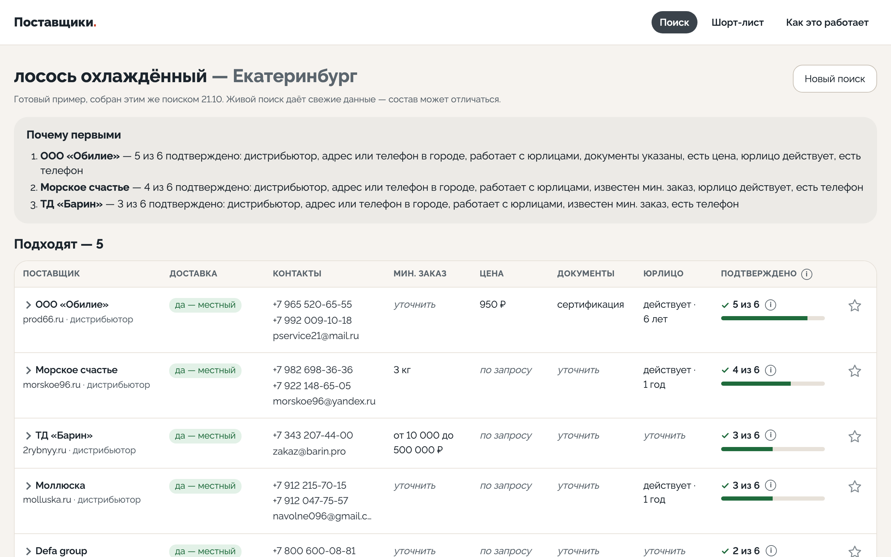
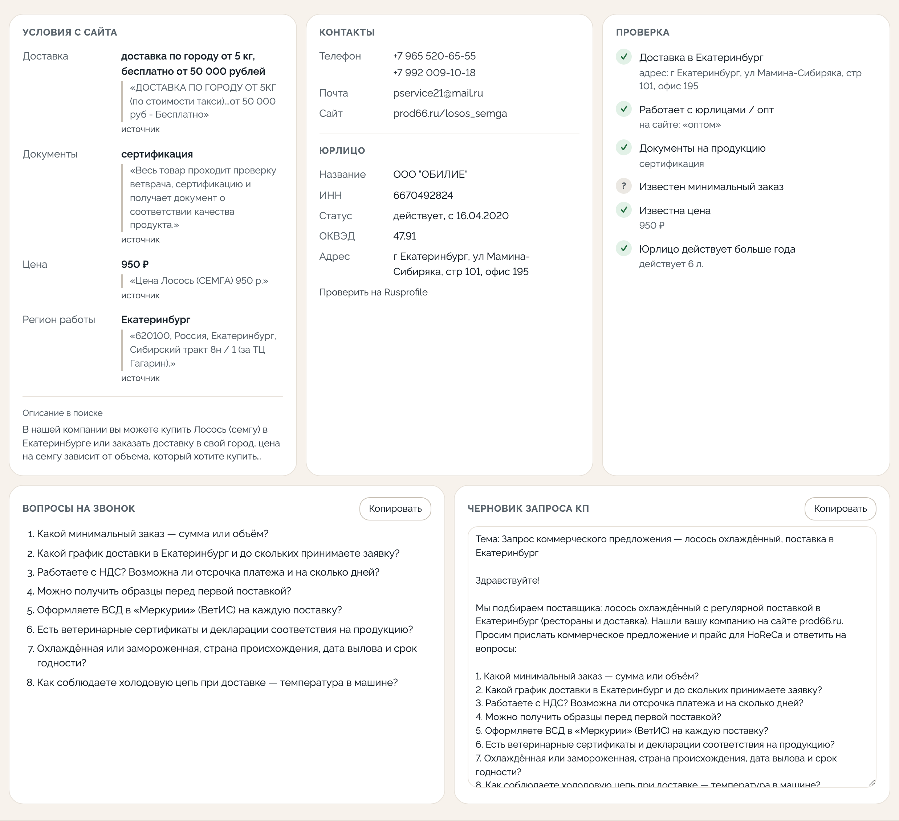

# Поставщики — поиск и проверка поставщиков продуктов для HoReCa

Закупщик вводит товар и город — за 30–60 секунд (готовые примеры собрались за 24–41 с) получает шорт-лист реальных поставщиков: контакты, условия с цитатами и ссылками, проверку юрлица, вопросы на звонок и черновик запроса КП.

**Прототип:** https://goulash-suppliers.vercel.app · **Как это работает:** https://goulash-suppliers.vercel.app/how





## Какую задачу решает

Найти поставщика — 20% работы. Остальные 80% — квалификация: отличить производителя от перекупа и маркетплейса, узнать мин. заказ, возят ли в нужный город, есть ли документы («Меркурий» для рыбы и мяса, «Честный знак» для молочки), живое ли юрлицо. Руками это 2–4 часа на одну категорию.

Для кого:
- **категорийный менеджер сети при выходе в новый город** — десятки категорий, под каждую заново искать местных производителей;
- **закупщик доставки** — альтернативные КП по ключевым позициям;
- **управляющий ресторана** — новое блюдо, подорожание, срыв поставки.

Сервис делает чёрную работу и оставляет человеку решение и звонок. Это не маркетплейс и не чат-бот.

## Как работает

```
категория + город
  → GigaChat: 5 поисковых формулировок (сбой → шаблоны)
  → Yandex Search API с регионом
  → отсев маркетплейсов и каталогов, склейка дублей          (код)
  → до 3 страниц каждого сайта: товар, контакты, доставка     (код, защита от SSRF, robots.txt)
  → телефоны, почта, ИНН — регулярками со страниц             (код)
  → условия: мин. заказ, цена, доставка, документы, оплата    (GigaChat, строгий JSON: значение + цитата)
  → проверка: цитата должна дословно быть на странице         (код)
  → юрлицо по ИНН: статус, возраст, ОКВЭД                     (DaData)
  → чек-лист из 6 пунктов, ранжирование, «почему первым»       (код)
  → группы «Подходят» / «Под вопросом» с причиной               (код)
  → вопросы на звонок по пробелам и правилам категории, КП    (код)
```

LLM делает только то, что без неё не сделать, — читает свободный текст сайтов. Всё, где нужна точность, делает код.

**Строгое «Подходят».** Туда попадает поставщик, только если подтверждено, что он продаёт эту категорию, и что возит в город: местный адрес или городской телефон, либо цитата про доставку. Розница, рестораны, другой регион и «не нашли, возят ли» — в свёрнутый список «Под вопросом» с причиной одной фразой. Лучше пять надёжных, чем пятнадцать вперемешку.

**Защита от выдумки.** Телефоны, почту и ИНН модель не выдаёт вообще. Каждое условие (мин. заказ, цена, доставка, документы, оплата, регион) — с дословной цитатой, которую код ищет на странице; не нашёл — поле отбрасывается и превращается в вопрос на звонок. В готовых примерах так отброшено 163 цитаты.

## Решения

| Решение | Почему | Что отверг |
|---|---|---|
| Живой веб-поиск, а не своя база | Базы поставщиков HoReCa по городам нет; демо на моках ничего не доказывает | Моки, парсинг одного каталога |
| Yandex Search API | Лучше всех находит российских поставщиков по городам | Зарубежные поисковые API |
| Чек-лист «n из 6» | Видно, что подтверждено, а что нет | Балл «87/100» без объяснения |
| Цена и мин. заказ только с цитатой | В отрасли «цена по запросу» — выдуманная цифра хуже пустой | Оценка цены моделью |
| Вопросы и КП — шаблоном в коде | Дёшево, предсказуемо, отраслевые правила явные | Генерация моделью |
| Линейный конвейер на httpx/asyncio | Граф линейный | LangGraph, векторная БД — понадобятся с ветвлениями и своей базой |
| Готовые примеры + живой поиск со стримингом | Пример открывается мгновенно, живой поиск показывает ход работы | Только живой поиск (медленно и платно) |
| Vercel, шорт-лист в браузере | Бесплатно, деплой из репозитория | Свой сервер ради прототипа |

## Честно о данных

По 7 готовым примерам (Екатеринбург, Казань): 111 найденных компаний, из них 38 в «Подходят». Телефон у 91 (82%), доставка в город подтверждена у 57, юрлицо проверено у 34, мин. заказ у 15, цена у 12. Цену, мин. заказ и документы большинство на сайте не пишет («по запросу»; документы указаны у 7 из 111) — поэтому эти пункты сразу превращаются в вопросы на звонок: ценность в подготовленном звонке, а не в таблице цен. Поиск: 24–41 с, 9–11 ₽.

Ограничения: местные производители без сайта веб-поиском не находятся (нужен поиск по организациям — Яндекс Карты, 2ГИС); часть сайтов закрыта антиботом — такие разбираются по сниппету с пометкой; данные устаревают — у результата дата сбора.

## Как это зарабатывает

- **Модуль закупок в SaaS для HoReCa** — надбавка к тарифу или фича удержания: поиска местных поставщиков с проверкой нет у учётных систем.
- **Своя база поставщиков** (следующий шаг) — копится из поисков и статусов шорт-листа «запросил КП / работаем / отказ».
- **Вторая сторона рынка** — поставщики платят за квалифицированные запросы КП.
- **Ценовые бенчмарки** — если у платформы есть накладные клиентов: например, «ваш лосось дороже медианы по городу на N%».

Экономика (допущения): поиск ~10 ₽ против 2–4 часов закупщика (1–2,5 тыс. ₽) на категорию; выход в новый город — 30–50 категорий. Главный эффект — не время, а альтернативные КП: по нашей оценке 1–3% фудкоста.

**Пилот:** одна сеть, один город, 10 категорий. Метрики: время до шорт-листа, доля рабочих телефонов, доля подтверждённых полей, число запросов КП, разница цены лучшего нового КП к текущей.

## Чего сознательно не делал

- **Вход и аккаунты** — для проверки гипотезы не нужны; шорт-лист в браузере; на сервере хранится только IP для лимита поисков — один час.
- **Своя база и векторный поиск** — базы поставщиков по городам нет; сначала живой поиск, база вырастет из поисков и обратной связи.
- **LangGraph и агенты** — конвейер линейный; граф понадобится с ветвлениями (рассылка КП, разбор ответов).
- **Оценка цены моделью** — выдуманная цифра хуже честного «по запросу».

## Что дальше

Поиск по организациям (местные производители без сайта) → рассылка запроса КП и разбор ответов-прайсов в сравнимую таблицу → обратная связь «позвонил» → интеграция с учётной системой: поставщик → номенклатура → первая поставка.

## Запуск

```bash
python3 -m venv .venv && .venv/bin/pip install -r requirements-dev.txt
cp .env.example .env   # ключи Yandex Search API, GigaChat, DaData (или ~/.config/goulash-suppliers/.env)
.venv/bin/uvicorn app.main:app --reload
.venv/bin/python -m app.cli "лосось охлаждённый" "Екатеринбург" --out result.json
.venv/bin/python -m pytest
```

Живой поиск на открытом демо ограничен: 3 в час с одного IP и суточный потолок (счётчики в Upstash Redis, локально — в памяти), вызов только POST со своей страницы. Загрузка чужих сайтов защищена от SSRF: только 80/443, адрес проверяется и используется один и тот же, без приватных сетей.

Готовые примеры пересчитываются `python scripts/precompute_demo.py`. Стек: Python 3.12+, FastAPI, httpx, Jinja2, ванильный JS.

Лицензия MIT.
